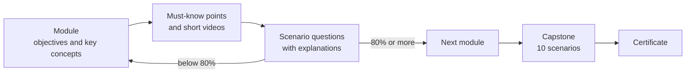

# SharePoint Administrator Course

**An eight-module course that prepares a team to support a SharePoint migration, aligned to CMMC Level 2, NIST SP 800-171, and ISO 9001, 20000-1, and 27001.**

[Take the course](https://share-admnistrator-course.vercel.app/)

---

## The problem

My team was supporting a SharePoint migration, and several teammates needed a deeper working knowledge of SharePoint before they could contribute with confidence.

A migration isn't only technical. Everyone on the team needs to understand how content, permissions, site structure, governance, and user needs fit together. The documentation that exists is written for administrators who already know the platform. I needed something that took people from understanding SharePoint, to practicing with it, to doing the migration work.

## What the course covers

| # | Module |
|---|---|
| 0 | Course overview |
| 1 | SharePoint architecture and administration |
| 2 | Permissions, role-based access, and least privilege |
| 3 | Microsoft 365 GCC and CMMC Level 2 compliance |
| 4 | Governance, taxonomy, and information architecture |
| 5 | Document control, records, and retention |
| 6 | Power Platform integration |
| 7 | Microsoft 365 integration: Teams, OneDrive, and hub sites |
| 8 | Management system compliance and audit readiness (ISO 9001, 20000-1, 27001) |
| — | Capstone assessment |

## How a learner moves through it

- **Each module** opens with its learning objectives and key concepts, then must-know points, warnings, and short video lessons.
- **Scenario questions** are built on workplace situations. After submitting, learners see which answers were right, with an explanation for each.
- **Learners need 80 percent to pass a module.** They can retry or move on.
- **A 10-question capstone** brings all eight modules together in realistic administrator scenarios. Passing it produces a certificate of completion.
- **An instructor view** holds answer keys with explanations, a concept glossary, common mistakes, and the learning objectives.

## Learning design

The course follows Bloom's Taxonomy, moving learners from remembering key terms to using them in real migration decisions.

| Level | In this course |
|---|---|
| Remember | Name SharePoint terms, tools, and administrator responsibilities. |
| Understand | Explain how sites, libraries, permissions, and metadata support collaboration. |
| Apply | Use those concepts to work through migration and administration scenarios. |
| Analyze | Compare site structures, permission models, and ways to organize content. |
| Evaluate | Recommend next steps for migration readiness and governance. |

## Decisions

| Decision | What I chose | What I didn't | Why |
|---|---|---|---|
| How it's delivered | One web page with no login | A learning platform | Anyone on the team can open it from a link, with nothing to install or license. |
| Progress | Saved in the learner's browser | Accounts and a database | Nothing to run or secure. The trade-off is that progress stays on one device. |
| Video | Embedded YouTube lessons | Recording and hosting my own | Good lessons already exist. Embedding keeps learners in the course instead of sending them to another site. |
| The instructor view | Open, for this portfolio demo | A password in the page | A password written into a web page can be read by anyone who opens the code. In a live deployment, the instructor view would sit behind the organization's own sign-in. |

## Built with

HTML, CSS, and JavaScript in a single file, [`sharepoint-admin-course.html`](sharepoint-admin-course.html), hosted on Vercel. There's no build step: open the file in a browser to run it locally.

## What comes next

- Role-based paths for administrators, content owners, and project managers
- Branching scenarios for migration decisions
- A downloadable migration readiness checklist
- Learner records in xAPI, so progress can move to a learning platform
- A full accessibility review

---

© 2026 Bytes with Don · [LinkedIn](https://www.linkedin.com/company/byteswithdon/) · [GitHub](https://github.com/byteswithdon)
